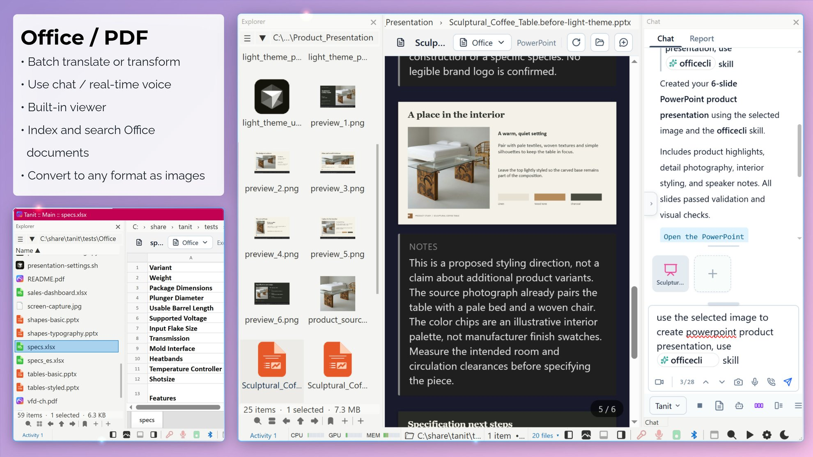
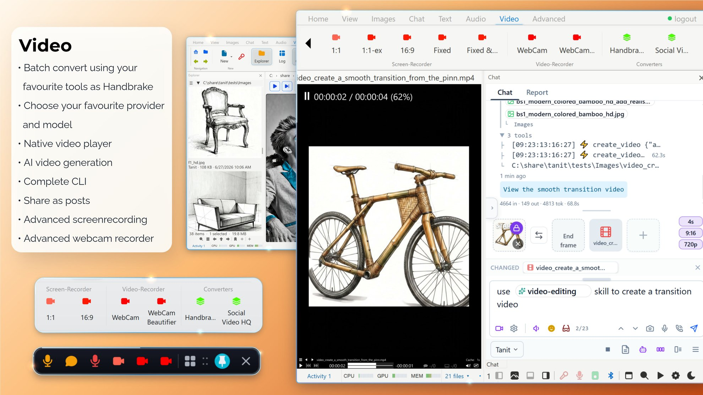
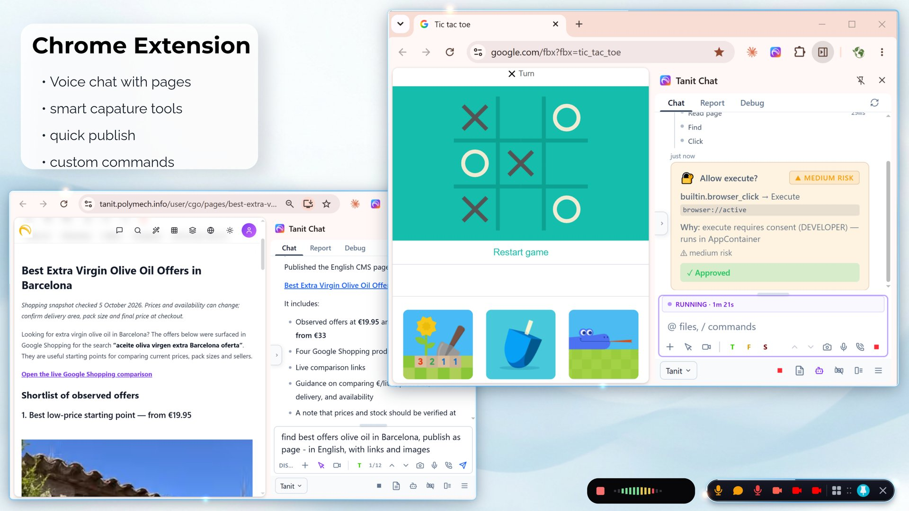
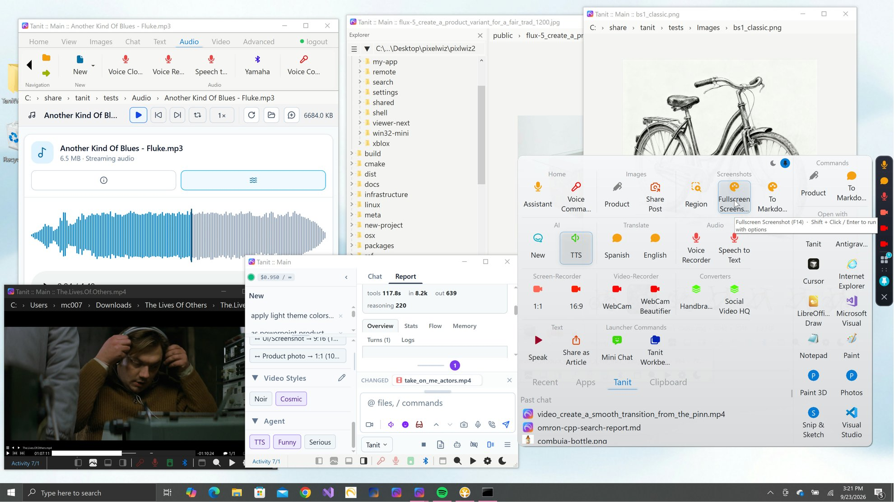
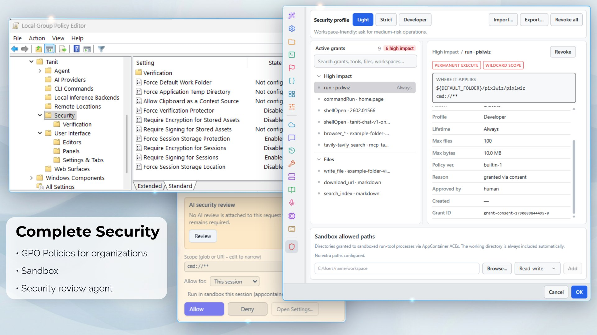

# Tanit Chat — screenshots

---

## Route each capability to the right model

Text, planning, vision, OCR, image generation, transcription, and speech each use a different local or cloud provider — never one vendor for everything.

---

## Talk instead of typing

Voice is a local capability first. Cloud realtime routing is opt-in when you want it.

---

## Inspect, batch, generate

Vision can stay on the device. Generation can go to the cloud. You choose per job.

---

## Blazing fast 3D preview, opens 40MB STEP in less than 2 seconds

Supports STEP, STL, FBX, VTK, USD, DXF, FreeCAD, OBJ, GLTF, GLB, and OpenSCAD.

---

## Office and PDF

Open a spreadsheet or a deck without a separate office suite.

---

## Play, capture, convert

Review clips in place, capture when you start it, convert in batch — same workspace as chat.

---

## Open Tanit beside any page, publish browser work as articles

Search, read, fill, translate, and talk without leaving the page. A task can start in Chrome and finish in a local file or an XBlox flow.

---

## Create and share from Tanit

Publish a report, an article, a set of pictures, or a file. Tanit uploads it to your account and gives you a link you can send.

---

## Turn a chat into a command

When the task repeats, save the successful process and run it on the next selection.

---

## Published in the launcher

A finished flow becomes a command you can run without opening the editor.

---

## Browser-use from a command

Drive a page or form with the same flow that started as a chat.

---

## Approve every action

Complete GPO support to lockdown providers, models, and interface. Security agent consent: once, task, session, limited time, always, or never.

---

## The file panel beside the viewer

Open a folder on this PC, connect a phone, browse SSH or FTP, preview files, copy between locations, or switch to a disk-usage view.
