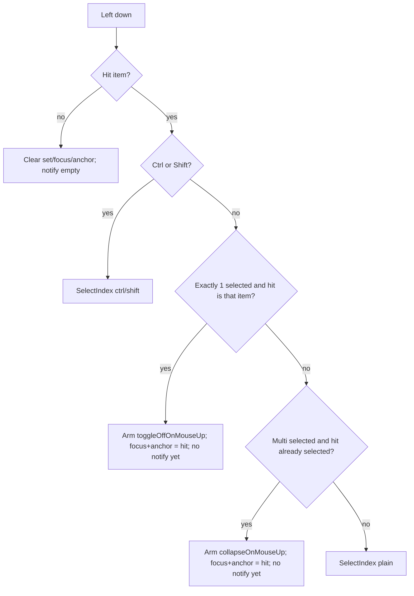
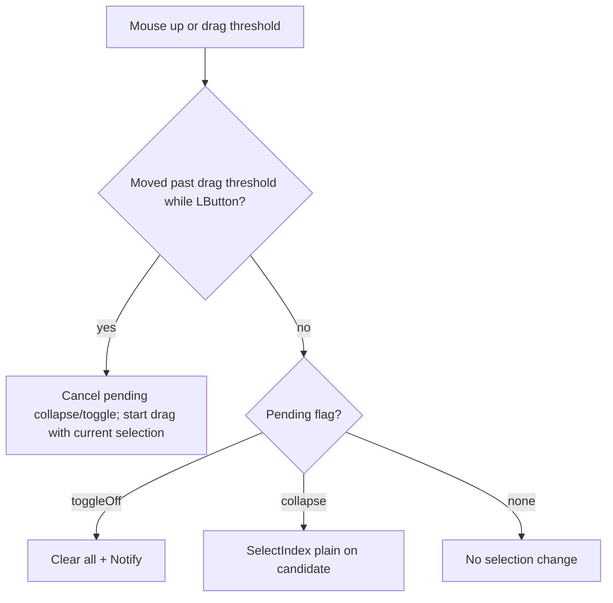
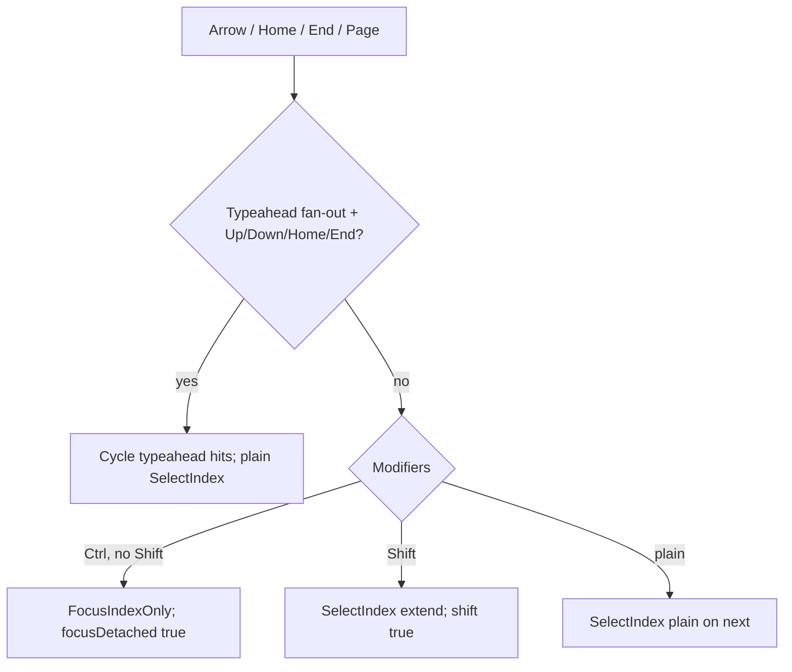
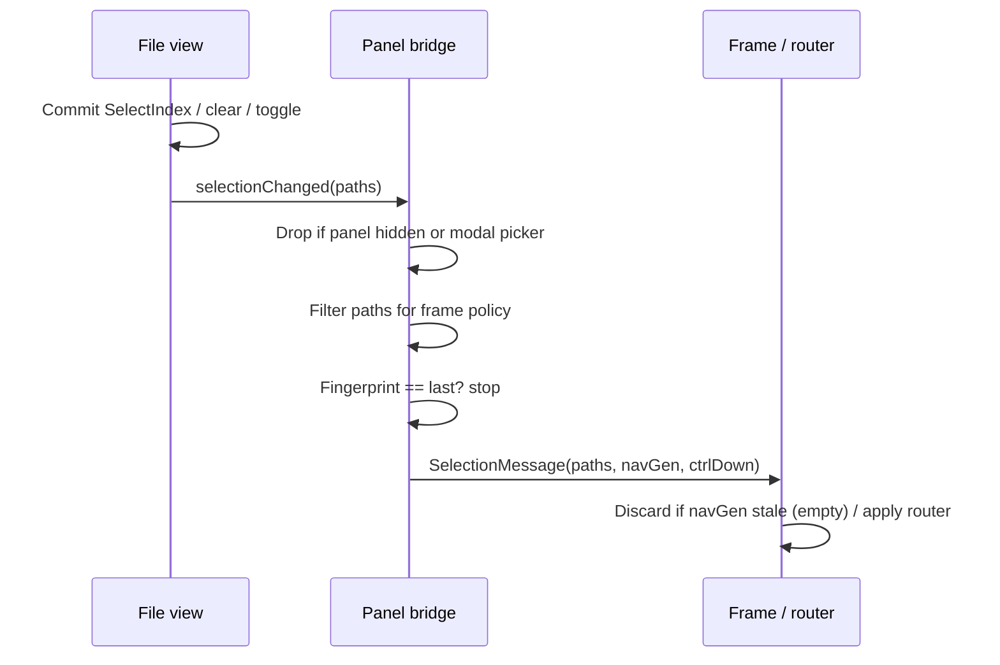

# File-panel selection — porting spec

Language-agnostic contract for Tanit file-panel **item selection** (single /
multi-select, focus vs selection, delivery). Incremental find is separate:
[typeahead.md](typeahead.md).

| | |
|---|---|
| **Shipping reference** | `CustomFileView_Selection.cpp` (`SelectIndex`, `HandleLeftButtonDown`, `NotifySelectionChanged`), `FileTreePanelCustom.cpp` (`NotifyCustomSelectionChanged`) |
| **Host / router inventory** | App-level producers, latches, chat merge → [win32/selection.md](../../docs/win32/selection.md) (repo) |
| **Chat agent snapshot** | [web-selection.md](../../docs/web/web-selection.md) (repo) |
| **Out of scope** | Typeahead / incremental find → [typeahead.md](typeahead.md) |

Ports must preserve Explorer-like **range + toggle** semantics, keep **focus**
distinct from **selection** where Ctrl-nav requires it, and never emit a
transient empty pick during refresh / navigation.

---

## 1. Goals / non-goals

### Goals

- Select zero or more items identified by **stable item ids** (not row indexes).
- Support plain / Ctrl / Shift mouse and keyboard selection with a persistent
  **anchor**.
- Deliver selection to the host **immediately** after committed input.
- Survive refresh: keep ids that still exist; do not flash empty to consumers.
- Support programmatic reveal (`SelectFile` / pending leaf) without selection
  storms.

### Non-goals (this spec)

- Workbench filtering (previewable types, chat-allowed paths) — host router.
- Chat filmstrip / `--src` pins / `context_removed` — web selection doc.
- Shell `IExplorerBrowser` polling quirks — only the **custom** panel contract
  here; fallback may still need retry timers.

---

## 2. Requirements

### Functional

| ID | Requirement |
|----|-------------|
| S1 | Selection is a set of **item ids**. Display indexes are ephemeral. |
| S2 | Every view has at most one **focus** index (`focusedIndex`) and one **anchor** index (`anchorIndex`). Anchor starts a Shift range. |
| S3 | Plain select: replace set with `{target}`, set focus + anchor to target. |
| S4 | Ctrl select: toggle target membership; set anchor to target; leave other members. |
| S5 | Shift select: select inclusive range from anchor → target in **visual order**; without Ctrl, clear set first; with Ctrl, union the range into the set. Focus moves to target; anchor stays. |
| S6 | Empty-background click: clear set, focus, anchor; notify empty. |
| S7 | Ctrl+A: select all **visible** display items; focus/anchor → 0 if focus was unset. |
| S8 | Keyboard arrows / Home / End / Page: move focus; Shift extends range from anchor; **Ctrl without Shift** moves focus only (`focusDetached`) without changing the set. |
| S9 | Space with Ctrl **or** `focusDetached`: toggle focused item in the set (Explorer Space). Plain Space may open lightbox / other host action — not required to toggle. |
| S10 | Typeahead / activate may call plain `SelectIndex` (replaces set). |
| S11 | Notify host after every committed change; **fingerprint-dedup** identical consecutive payloads. |
| S12 | Hidden / invisible panel must **not** emit selection (incl. empty). |
| S13 | Refresh in same folder: drop ids no longer in the model; restore focus by id when possible; emit **at most one** notification; never an intermediate empty. |
| S14 | Folder / provider change: clear selection (unless a pending reveal leaf is queued); pending select applies after enumeration without empty intermediate. |
| S15 | Path list for host: filesystem path if present, else canonical URI; tree layout may prefer tree’s path list. Order follows **display order**. |

### Non-functional

| ID | Requirement |
|----|-------------|
| N1 | No paint-time Shell / COM / network for selection. |
| N2 | Post/async delivery must carry a **navigation generation** so the host can discard stale empties. |
| N3 | Modal path pickers must gate selection delivery (no preview thrash). |

### Platform mapping

| Concern | Win32 reference | Port guidance |
|---------|-----------------|---------------|
| Modifiers | `GetKeyState(VK_CONTROL/SHIFT)` | Platform modifier flags at event time |
| Message | Heap `ExplorerSelectionMsg` + `PostMessage(UWM_EXPLORER_SELECTION)` | Event / callback with `{paths, navGeneration, ctrlDown, source}` |
| Ownership | Receiver frees payload | Same for heap/async; sync callbacks need no free |
| Ctrl-additive chat | `ctrlDown` on message → host merges into chat extras | Optional; document if host supports it |
| Drag threshold | `SM_CXDRAG` / `SM_CYDRAG` | System or ~4 px |

---

## 3. Data model

```text
SelectionState {
  selectedIds:   set<itemId>     // membership
  focusedIndex:  int | -1        // caret / keyboard focus (display index)
  anchorIndex:   int | -1        // Shift-range origin (display index)
  focusDetached: bool            // focus moved without changing set (Ctrl-nav)
}

// Transient mouse / drag (not persisted)
MouseSelectPending {
  collapseOnMouseUp: bool   // multi-select click on a selected item → collapse if not drag
  toggleOffOnMouseUp: bool  // sole selected re-click → deselect if not drag
  dragCandidateIndex: int
}

// Host delivery
SelectionMessage {
  paths:          [string]   // display-order paths/URIs
  navGeneration:  uint       // monotonic per panel navigation epoch
  ctrlDown:       bool       // Ctrl held when committed
  source:         panelId
}
```

**Invariant:** `focusedIndex` / `anchorIndex` are display indexes into the
**current** visible list. After filter/sort/refresh, re-resolve via item id
when possible; clamp or clear when the id is gone.

**Invariant:** `SelectedItemIds()` / path export iterate **display order**, not
hash-set order.

---

## 4. Core algorithm — `SelectIndex`

```text
SelectIndex(index, ctrl, shift, ensureVisible = true):
  if index out of range: return

  if not ctrl:
    focusDetached = false

  targetId = itemIdAt(index)

  // No-op: plain re-assert of the sole already-focused pick
  if not shift and not ctrl
     and selectedIds == {targetId}
     and focusedIndex == index:
    return

  if shift and anchorIndex >= 0:
    if not ctrl:
      selectedIds.clear()
    for each displayIndex in visualRange(anchorIndex, index):  // inclusive
      selectedIds.insert(itemIdAt(displayIndex))
    // anchor unchanged
  else if ctrl:
    toggle targetId in selectedIds
    anchorIndex = index
  else:
    selectedIds = {targetId}
    anchorIndex = index

  focusedIndex = index
  if ensureVisible: scroll focus into view
  NotifySelectionChanged()
```

### Visual range

- Ungrouped list/grid: contiguous index range `min(anchor, index)…max(...)`.
- Grouped / type-grouped rows: range over **visual item order** (skip group
  headers), inclusive between the two positions in that order.

```text
visualRange(a, b):
  order = CollectVisualItemOrder()   // item display indexes only
  ia = position of a in order; ib = position of b
  return order[min(ia,ib) … max(ia,ib)]
```

---

## 5. Input flows

### 5.1 Mouse left-down



### 5.2 Mouse up / drag



Rules:

- Re-click sole selection: keep highlight through a possible drag; **deselect on
  mouse-up** if no drag (chat context drops with the highlight).
- Click an already-selected item inside a multi-selection: keep the multi-set
  for drag; **collapse to that item on mouse-up** if no drag.
- Drag uses the **current** selection paths/URIs (and PIDLs when needed).

### 5.3 Keyboard movement



`MoveFocus(delta)` walks visual order when grouped; otherwise clamps
`focusedIndex + delta` (grid uses column stride for Up/Down).

### 5.4 Notify → host



---

## 6. Refresh, navigation, pending select

### Same-folder refresh / incremental enum

```text
valid = { id in selectedIds | id still in model }
selectedIds = valid
re-resolve focusedIndex from previous focused id when possible
clamp focus if past end
Notify once when commit is complete (or pending reveal abandoned)
do NOT notify empty while a pending leaf is still queued
```

### Location change

```text
selectedIds.clear()
scrollOffset = 0
if pendingSelectName empty:
  focusedIndex = first item or -1
  clear tree path cache
else:
  keep pending; apply SelectFile when leaf appears
```

### Pending select API

| API | Behaviour |
|-----|-----------|
| `Navigate(folder, selectFileAfter)` | Sets pending atomically with navigation |
| `QueueSelectFile(name)` | Try `SelectFile` now; else queue until enum; empty clears |
| `RevealPath(path)` | Same folder → `SelectFile`; else `Navigate(parent, leaf)` |
| `NavigateUp` | Pending = leaf of folder being left |
| `NavigateBack` / `Forward` / plain `Navigate(folder)` | Clears pending |

`SelectFile(name)`: match display name or full filesystem path
(case-insensitive); then plain `SelectIndex`.

Do **not** `Navigate(folder)` then hope a later field write sticks — Navigate
replaces the pending name.

---

## 7. Focus vs selection vs paint

| Concept | Meaning | Paint |
|---------|---------|--------|
| Selected | In `selectedIds` | Selection background / text (active or inactive) |
| Focused | Keyboard caret row | Focus rectangle when panel focused |
| Hover | Pointer hit | Hover wash; independent of selection |
| `focusDetached` | Focus moved off the “exclusive” selection story | Focus rect may sit on an unselected row |

Inactive panel: use inactive selection colors; still keep ids.

Theme (reference): active selection `COLOR_HIGHLIGHT` / `COLOR_HIGHLIGHTTEXT`;
inactive `COLOR_BTNFACE`; high-contrast from system colors.

---

## 8. Edge cases

| Case | Required behaviour |
|------|--------------------|
| Shift with no anchor | Treat like plain or no-op range; shipping sets anchor on plain/Ctrl first |
| Ctrl+Shift range | Union range into existing set; anchor unchanged |
| Toggle last selected via Ctrl | Set may become empty while focus remains — notify empty paths |
| Filter mask change | Drop ids not in visible set; clamp focus |
| Sort / regroup | Ids stay; indexes change — rebuild focus/anchor from ids when practical |
| SelectFile miss after complete enum | Clear pending; on location change fall focus to index 0 |
| Viewer next/prev host pick | Must not collapse an unrelated stable multi-select in another panel; fingerprint + generation help |
| Empty shell-era tick | Custom backend: emit empty **only** for explicit user clear (background click, toggle-off, etc.) |
| Tree layout | Selection may be owned by tree control; path export prefers tree paths; suppress notify storms during rebuild (`suppressSelectionNotify`) |
| Glob select | May replace set with all mask matches; focus first match |
| Delete | Remember neighbor for pending reselect; release previews before paths vanish |
| Dual file panels | Message carries `source`; host routes per-panel |

---

## 9. Delivery contract (host-facing)

```text
On committed selection:
  paths = CurrentFileSystemSelection()   // display order
  post SelectionMessage {
    paths,
    navGeneration,   // bump on each successful navigation
    ctrlDown,        // Ctrl at commit time
    source
  }

Guards ports must implement or document:
  G-fingerprint  — identical path fingerprint → no post
  G-hidden       — invisible panel → no post
  G-modal        — modal path picker → no post
  G-navGen       — host discards stale empty posts from older epochs
  G-pending      — no empty notify while programmatic leaf still queued
```

Workbench may further filter `paths` (previewable types, chat-allowed). That
filter is **not** part of the view’s selection set — the view keeps raw ids;
`GetCurrentRawSelection()` / path export remains the live source for commands.

---

## 10. Related surfaces (not specified here)

- **Typeahead** replaces selection with the best hit / fan-out cycle — [typeahead.md](typeahead.md).
- **Router dual lists** (filtered vs status/raw), startup latch, chat
  `context_extra` / removal — win32 + web selection docs.
- **Ctrl-additive explorer → chat**: when `ctrlDown` and the new pick is a
  strict superset, host may append to chat extras instead of replacing.

---

## 11. Conformance checklist

- [ ] Selection stored by stable item id; path export in display order.
- [ ] Plain / Ctrl toggle / Shift range (visual order, grouped-aware).
- [ ] Anchor updated on plain and Ctrl; preserved on Shift.
- [ ] Empty click clears and notifies once.
- [ ] Sole re-click deselects on mouse-up; multi click collapses on mouse-up; both defer to drag.
- [ ] Ctrl+arrows focus-only with `focusDetached`; Space toggles when detached/Ctrl.
- [ ] Ctrl+A selects all visible.
- [ ] Same-folder refresh reconciles ids; no intermediate empty notify.
- [ ] Location change clears set; pending select applies without empty flash.
- [ ] Hidden panel and modal picker emit nothing.
- [ ] Delivery includes nav generation + optional ctrlDown; fingerprint dedups.
- [ ] Focus rectangle and active/inactive selection colors distinct.
