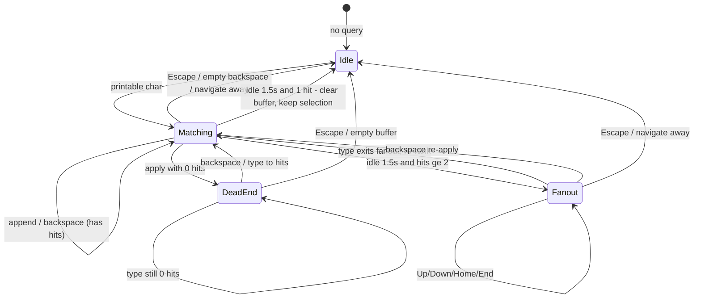
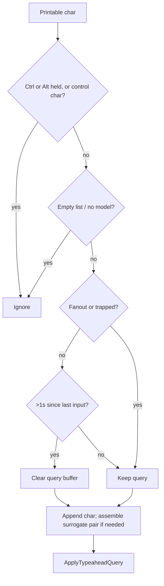
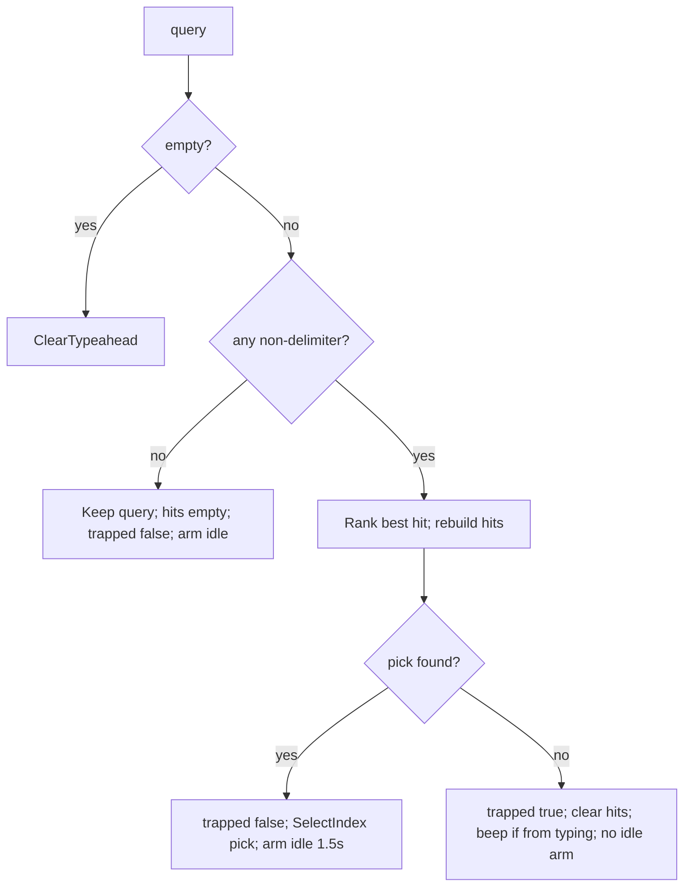
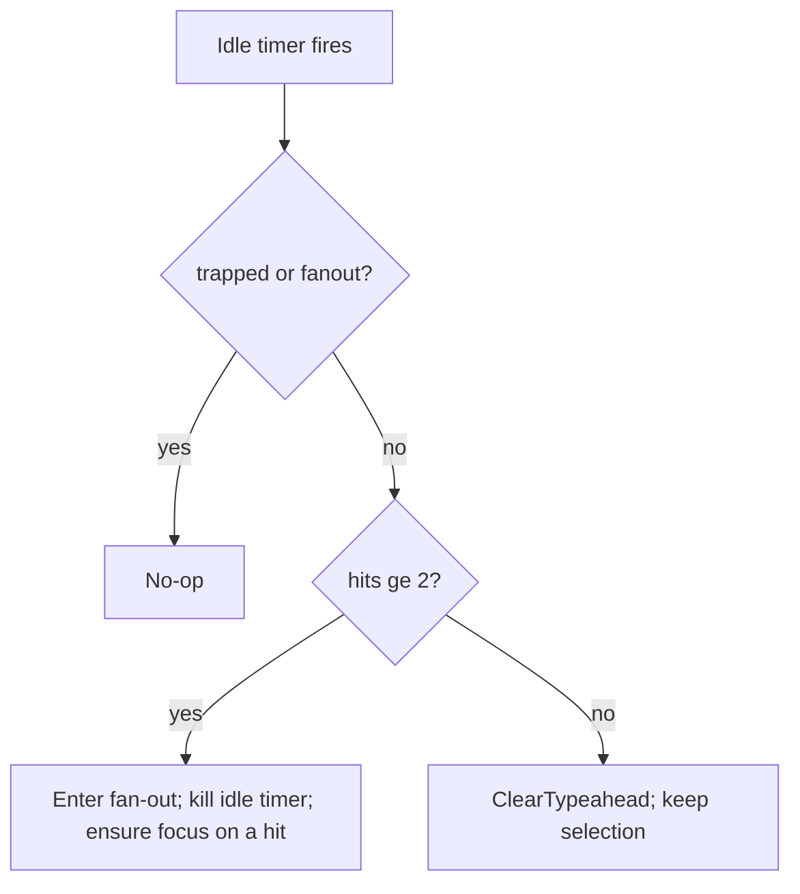
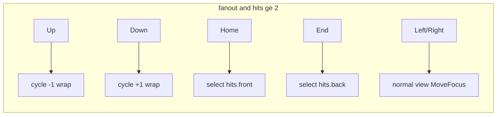

# File-panel incremental find (typeahead) — porting spec

Language-agnostic contract for Tanit file-panel **incremental find**.
Not Windows Explorer type-select (prefix + repeat-letter cycle).

| | |
|---|---|
| **Shipping reference** | `TypeaheadMatch.hpp`, `HandleTypeaheadCharacter` / `TypeaheadBackspace` / `ApplyTypeaheadQuery`, `DrawItemName` |
| **Host doc** | [filepanel-next.md](../filepanel-next.md) (typeahead section) |
| **Out of scope** | Multi-select / selection delivery → [selection.md](selection.md) |

Prefix-only fails on media names (`The.part.mp4`, `S01E02.720p.mkv`). Ports must
implement literal substring + delimiter-folded fallback with the ranking and
lifecycle below.

---

## 1. Goals / non-goals

### Goals

- Fast, CPU-only find while typing in a file list.
- Match mid-name tokens without requiring the user to type separators.
- Keep selection meaningful: pick a best hit immediately; after idle, either
  clear the find buffer (1 hit) or enter fan-out so Up/Down cycles all hits.
- Paint the same match span the matcher computed (no second ranking at paint).
- Stay correct for UTF-16 / surrogate pairs and logical (not visual) string order.

### Non-goals (v1)

- Accent folding / Unicode normalization (NFD/NFC).
- Filtering the list (find does not hide rows).
- Explorer-style “same letter advances to next prefix”.
- IME composition awareness (gap — see §8).
- Fuzzy subsequence, edit-distance, or embeddings (roadmap — see §9).

---

## 2. Requirements

### Functional

| ID | Requirement |
|----|-------------|
| F1 | Match is case-insensitive **substring** of each item’s `displayName` in **logical** order. |
| F2 | Ranking per query: **1** literal prefix → **2** literal substring → **3** folded prefix → **4** folded substring. Select the first best hit in **display / visual order**. |
| F3 | Folded match runs **only** when that name has **no** literal hit. Both query and name drop delimiters before compare. |
| F4 | Empty folded text never matches. Delimiter-only queries may remain in the buffer with zero hits. |
| F5 | Extending the query can drop a literal hit and reveal a folded one — always re-scan the **full** visible list (non-monotonic; do not search only the previous hit set). |
| F6 | Typing always **appends** one user character; never “repeat letter = next hit”. Typing exits fan-out and re-ranks. |
| F7 | Backspace deletes one user-perceived character (surrogate-safe), re-runs match; empty query exits find. |
| F8 | Zero hits → dead-end: audible cue (optional on backspace repair), status “No matches”, query kept; Backspace / further typing repair. Not locked until Escape. |
| F9 | Escape clears query, hits, fan-out, and dead-end. Selection is kept unless a separate navigation clears it. |
| F10 | Idle (~**1500 ms**) after a successful match: **1 hit** → clear buffer (selection kept, highlight off). **≥2 hits** → enter **fan-out**. |
| F11 | Fan-out: Up/Down cycle hits with wraparound; Home/End → first/last hit. Left/Right remain normal view navigation. |
| F12 | Find does not filter the list; scope is current **visible / filtered display order**. |
| F13 | After filter / sort / refresh: recompute hits by **stable item id**, not cached row indexes. |
| F14 | Paint reuses the match range from the hit rebuild (same mode + code-unit span). |

### Non-functional

| ID | Requirement |
|----|-------------|
| N1 | Case compare: ordinal, case-insensitive only (Win32 reference: `CompareStringOrdinal(…, TRUE)`). No diacritic folding. |
| N2 | Hot path stays on the UI/CPU thread; no network / embedding calls. |
| N3 | Acceptance intent (not gated CI): p95 &lt; ~10 ms for ~10k names on the slowest supported CPU; cache compressed/normalized forms when the listing changes; generation-counter if work moves off-thread. |

### Platform mapping (ports)

| Concern | Win32 reference | Port guidance |
|---------|-----------------|---------------|
| String unit | UTF-16 code unit (`wchar_t`) | Match ranges are in the **same** code units as `displayName` storage. On UTF-8 hosts, document that ranges are Unicode scalar / UTF-8 byte / UTF-16 — pick one and keep paint consistent. |
| Case fold | `CompareStringOrdinal(..., TRUE)` | Equivalent: case-insensitive ordinal / invariant culture; **not** locale collation. |
| Whitespace | `iswspace` | Unicode whitespace for delimiter set. |
| Surrogates | `IS_SURROGATE_PAIR` / high-then-low `WM_CHAR` | Append / backspace must treat a surrogate pair as one user character. |
| Beep | `MessageBeep` on dead-end from typing | Optional; status “No matches” is required. |

---

## 3. Data model

### 3.1 Match result

```text
Match {
  begin: index   // inclusive, into displayName
  end:   index   // exclusive
  prefix: bool   // literal: begin==0; folded: compressed index==0
  folded: bool   // false = literal substring; true = delimiter-stripped
}

ok(m)         <=> begin != none AND end > begin
valid_for(m,n) <=> ok(m) AND end <= length(n)
```

Paint must reject stale ranges after rename / model swap via `valid_for`.

### 3.2 Session state

```text
TypeaheadState {
  query:            string          // find buffer (may be delimiter-only)
  hits:             [displayIndex]  // visual order, all matching rows
  matches:          map<itemId, Match>  // paint source of truth
  trapped:          bool            // dead-end: query has no hits
  fanout:           bool            // idle multi-hit: cycle with Up/Down
  caretOn:          bool            // status-bar caret blink
  lastInputTick:    timestamp
  pendingHighSurrogate: optional code-unit  // UTF-16 hosts only
}
```

Clearing find mode zeros all of the above (and cancels idle / blink timers).
**Selection / focus are not cleared** by find clear alone.

### 3.3 Delimiters (folded mode)

A character is a delimiter iff:

- Unicode whitespace, **or**
- **ASCII punctuation** in these inclusive ranges (letters/digits stay):

```text
! … /     (U+0021 … U+002F)
: … @     (U+003A … U+0040)
[ … `     (U+005B … U+0060)
{ … ~     (U+007B … U+007E)
```

Includes `"$%*?^` etc. Intentionally **not** full Unicode punctuation (`iswpunct`
equivalents) — folded find only strips ASCII separators + whitespace.

### 3.4 Compress map

```text
Compress(s) -> { text, map[] }
  for i in 0 .. len(s)-1:
    if not IsDelimiter(s[i]):
      text.append(s[i])
      map.append(i)   // compressed index → original index
```

Folded match uses `FindIgnoreCase(hay.text, query.text)` then maps back:

```text
begin = hay.map[at]
end   = hay.map[at + queryLen - 1] + 1   // half-open in original
prefix = (at == 0)
folded = true
```

---

## 4. Algorithms

### 4.1 Literal find

```text
FindLiteral(name, needle):
  if needle empty: return none
  at = first index where name[at .. at+len) equals needle case-insensitively
  if none: return none
  return { begin: at, end: at+len, prefix: at==0, folded: false }
```

### 4.2 Folded find

```text
FindFolded(name, needle):
  q = Compress(needle)
  if q.text empty: return none          // never match-all
  h = Compress(name)
  at = FindIgnoreCase(h.text, q.text)
  if none: return none
  return mapped Match as in §3.4
```

### 4.3 Per-name membership (hit list / paint)

```text
Find(name, needle):
  lit = FindLiteral(name, needle)
  if lit.ok: return lit
  return FindFolded(name, needle)
```

### 4.4 Best-hit ranking (focus pick)

Scan display order once. Prefer earliest **literal prefix**; else keep first
literal substring, first folded prefix, first folded substring as fallbacks.
Stop early only when a literal prefix is found.

```text
pick = none
literalSub = foldedPrefix = foldedSub = none

for each displayIndex in displayOrder:
  lit = FindLiteral(name, query)
  if lit.ok:
    if lit.prefix: return displayIndex     // rank 1 — done
    if literalSub is none: literalSub = displayIndex
    continue                               // do not folded-scan this name
  folded = FindFolded(name, query)
  if folded.ok:
    if folded.prefix and foldedPrefix is none: foldedPrefix = displayIndex
    else if not folded.prefix and foldedSub is none: foldedSub = displayIndex

return first non-none of (literalSub, foldedPrefix, foldedSub)
```

Then rebuild the full hit list with `Find` for every visible item (visual
order, skipping group headers). Store `matches[itemId] = match`.

### 4.5 Worked examples

| Query | Name | Mode | Notes |
|-------|------|------|-------|
| `part` | `The.part.mp4` | literal mid | rank 2 |
| `thepart` | `The.part.mp4` | folded | compress both → `thepart` |
| `the part` | `The.part.mp4` | folded | spaces stripped from query |
| `the.part` | `The.part.mp4` | literal prefix | dots kept in literal |
| `...` | anything | no match | delimiter-only; buffer may stay |
| `PART` | `part1.txt` | literal | case-insensitive ordinal |
| `café` vs `cafe` | — | no match | no accent folding |

---

## 5. Flows

### 5.1 State machine



### 5.2 Character input



### 5.3 Apply query



### 5.4 Idle expiry (~1500 ms)



### 5.5 Fan-out navigation



If focus is not currently on any hit when entering fan-out, select `hits[0]`.

---

## 6. Lifecycle & exit conditions

Clear find mode (**keep selection** unless the same action navigates away) when:

| Event | Clears find? | Notes |
|-------|--------------|-------|
| Escape | yes | Also clears trapped / fan-out |
| Backspace to empty query | yes | Further Backspace → parent folder (host) |
| Idle, exactly 1 hit | yes | Selection stays on that item |
| Folder / provider change, Navigate*, NavigateUp | yes | |
| Enter-activate / open item | yes | Host clears before/with activation |
| Rename mode | yes | |
| Mouse click elsewhere | **no** | Selection may change; highlight tracks buffer until cleared |
| Filter / sort / refresh | **recompute** | Rebuild by item id; do not trust old display indexes |

---

## 7. UI / paint contract

### Status find band

When `query` non-empty, status bar shows a right-priority find band:

```text
Find: <FSI>query<PDI> [meta]
```

- `FSI` = U+2068, `PDI` = U+2069 — first-strong isolation so RTL queries do not
  reorder the meta suffix.
- Meta:
  - trapped → ` — No matches`
  - ≥2 hits → ` n/total` (1-based ordinal of focused hit; if focus not in set, show `1`)
  - fan-out → append ` ↑↓`
- Find band has layout priority; left status text ellipsizes in the remainder.
- Blinking caret after the query (system caret blink period; one physical pixel).

### Item name highlight

- Prefer: shape the **whole** filename, then bold/weight the match range
  (DirectWrite `SetFontWeight` on a range when available).
- v1 fallback: LTR single-line → draw before / **match** / after with bold mid.
- Complex scripts (Arabic, Hebrew, and related blocks / bidi controls):
  **bold the whole name** — never split before/match/after (breaks joining).
- Wrapped captions: whole-name bold (same reason).
- Offset units: same as matcher; expand to full grapheme clusters when the
  text stack supports it.

---

## 8. Edge cases & gaps

| Case | Required behaviour |
|------|--------------------|
| Delimiter-only query (`.`, `...`, spaces) | Stay in buffer; zero hits; not trapped; idle may clear |
| Empty folded after compress | No match (never match every name) |
| Non-monotonic extend (`pa`→literal, `pat`→only folded elsewhere) | Full rescan every apply |
| Surrogate pair typing | Buffer high surrogate until low arrives; treat as one char |
| Surrogate backspace | Pop two code units when last two form a pair |
| Dead-end then repair | Keep query; backspace/type re-apply; beep only when typing into empty |
| Fan-out + type | Exit fan-out, append, re-rank |
| Fan-out + idle timer | Idle ignored while fan-out or trapped |
| Fresh buffer after pause | If **not** fan-out/trapped and &gt;~1s since last input, clear before append (new find session) |
| Grouped view | Hit order follows visual item order (skip headers) |
| Stale match after rename | `valid_for` fails → paint plain name |
| Ctrl/Alt + char | Not typeahead input |
| Space | Host may use Space for lightbox / toggle-select; only printable path without modifiers enters find when the host routes it — Win32 reference does **not** feed Space through `HandleTypeaheadCharacter` via keydown Space handlers; ports should match host key routing |
| IME composition (**gap**) | Spec intent: search **committed** text only; suspend idle during composition; let IME consume arrows/Esc first. **Not implemented in v1.** |

---

## 9. Roadmap (non-shipping)

| Tier | Method | Example | Notes |
|------|--------|---------|-------|
| Now | Literal + folded | `part` / `thepart` → `The.part.mp4` | This spec |
| Next | Scored subsequence | `thprt` → `The.part.mp4` | ≥3 chars; highlight matched glyphs; fzf-style greedy |
| Later | Bounded typo | `vacaton` → `Vacation.mp4` | ≥4 chars; ≤1 edit short / 2 long; label Approximate |
| Optional mode | Embeddings | `summer holiday` → `Beach trip Spain.mp4` | Explicit “Search by meaning”; no char span |

Keep [`src/lib/llm/llama/EmbeddingModel.cpp`](../../src/lib/llm/llama/EmbeddingModel.cpp)
on the radar for semantic mode (precompute file vectors, debounce query embed on
a worker, separate result lane). Typeahead hot path stays CPU-only.

Useful libraries for later tiers: [rapidfuzz-cpp](https://github.com/rapidfuzz/rapidfuzz-cpp).

---

## 10. Conformance checklist (for ports)

- [ ] `FindLiteral` / `FindFolded` / `Find` match §4 (incl. empty folded → none).
- [ ] Delimiter set is ASCII punct ranges + whitespace only.
- [ ] Rank order 1→4; early exit only on literal prefix.
- [ ] Hit list is full visible set in visual order; paint reads cached `Match` by id.
- [ ] Typing appends; no repeat-letter cycle; exits fan-out.
- [ ] Backspace is surrogate-safe; empty exits find.
- [ ] Dead-end keeps query; Escape clears all find state.
- [ ] Idle 1.5s: 1 hit clears buffer; ≥2 enters fan-out with Up/Down/Home/End.
- [ ] Navigate / provider change clears find; refresh recomputes by item id.
- [ ] Status find band uses FSI/PDI; complex scripts avoid mid-name split.
- [ ] No list filtering; case compare is ordinal / invariant, not accent-folding.
