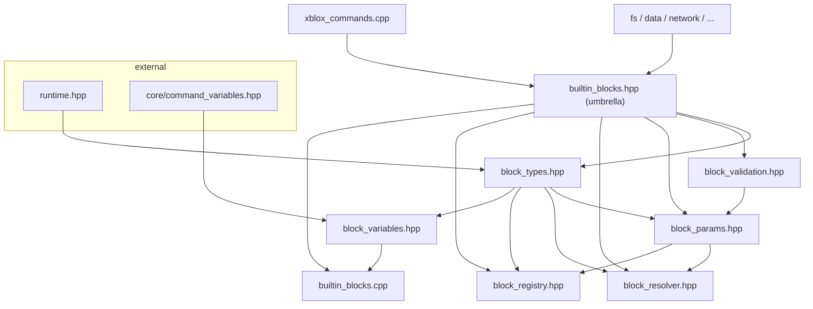
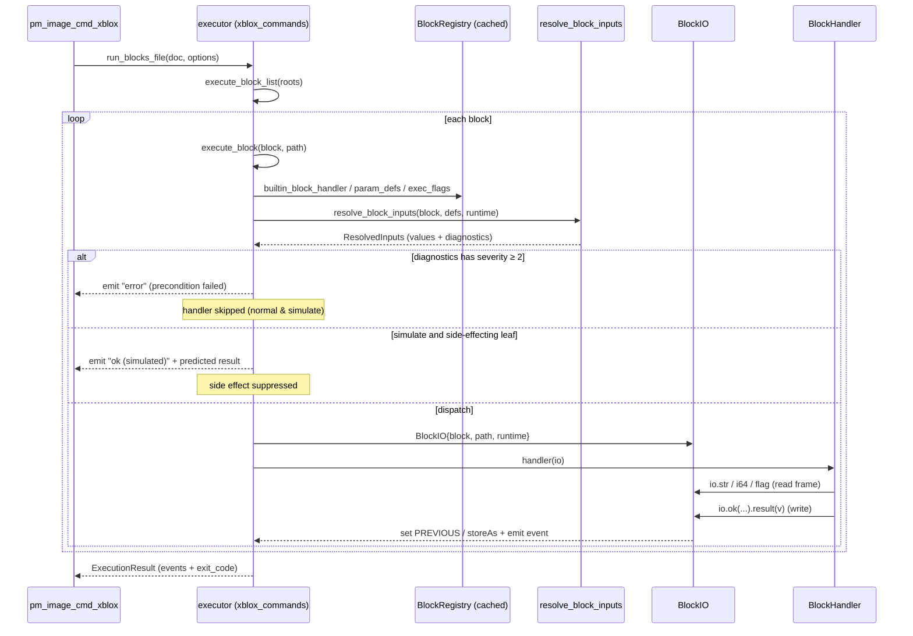
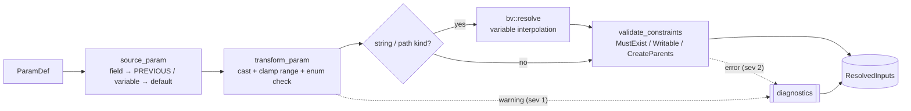
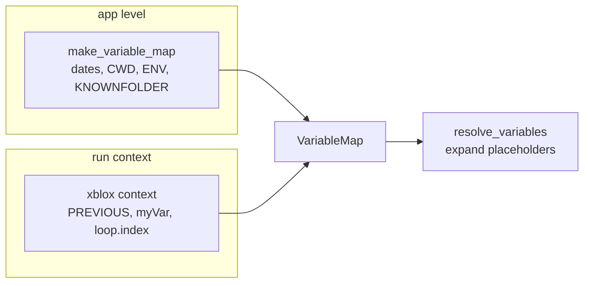
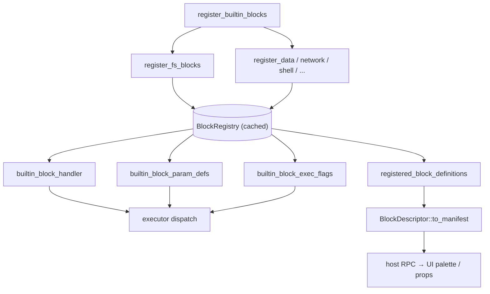

# XBlox Architecture

A map of the native XBlox runtime: what the pieces are, how the headers depend
on each other, and how a block runs. For the design narrative and per-slice
history see [`xblox-next.md`](./xblox-next.md); this file is the structural
overview.

## Overview

XBlox executes a **document of blocks** (a JSON tree of `roots` + `context`).
Blocks are plugin-style units described by a self-contained **manifest**
(`BlockDescriptor`) and implemented as pure-ish handlers over a typed facade
(`BlockIO`). The runtime is a single C++ core shared by the CLI and the desktop
UI.

The core idea is a **resolve-then-dispatch** pipeline: the executor sources,
casts, interpolates and precondition-checks every declared parameter *before* a
handler runs, into a typed `ResolvedInputs` frame. Handlers therefore never touch
`nlohmann::json`, `PREVIOUS`, variables, or filesystem preconditions — they read
finished typed values and write results/events through sinks. This makes the same
machinery support **simulation** (suppress side effects, keep dataflow) and
**diagnostics** (validation/preconditions surfaced as events) for free.

Three layered subsystems:

- **Executor** (`xblox_commands.*`) — walks the block tree, owns control flow,
  scopes, events, and the `BlockRuntime` sink table.
- **Block runtime** (`blocks/block_*.hpp`) — the type vocabulary, parameter
  schema, resolver, registry, and the built-in/plugin handlers.
- **Scope + parameters** (`Scope.*`, `Context.*`, `Parameter*.*`) — `NH_`-backed
  numeric variable frames bound to muParser for expression evaluation.

## Files

| Layer | File | Role |
|---|---|---|
| Public API | `xblox_commands.hpp` | `run_blocks_file` / `run_block_roots` / `build_execution_plan` |
| | `runtime.hpp` | `ExecutionEvent/Options/Result`, `ScopePolicy`, `BlockRunFlag` |
| Executor | `xblox_commands.cpp` | `execute_block_list` → `execute_block`, `RuntimeBridge` sinks, simulate + diagnostics, background/cancel, command payloads |
| Block runtime | `blocks/builtin_blocks.hpp` | **umbrella** re-exporting the headers below |
| · types / IO | `blocks/block_types.hpp` | `BlockRuntime`, `Value`, `Diagnostic`, `ResolvedInputs`, `EventBuilder`, `BlockIO`, `BlockHandler`, `legacy()`/`HandlerArg` |
| · validation | `blocks/block_validation.hpp` | `ParamConstraint` bitmask |
| · parameters | `blocks/block_params.hpp` | `ParamSource`, `ParamDef`, `pd_*` factories |
| · resolver | `blocks/block_resolver.hpp` | `source_param`, `BlockIO::def/resolved`, `resolve_block_inputs` |
| · registry | `blocks/block_registry.hpp` | `ExecFlags`, `ChildListDef`, `BlockDescriptor`, `bdb()`, `builtin_block_*` lookups |
| · variables | `blocks/block_variables.hpp` | `bv::resolve` — `${var}` interpolation incl. app-level vars |
| · impl | `blocks/builtin_blocks.cpp` | registry build, `transform_param`, `validate_constraints`, `resolve_block_inputs` |
| Handlers | `blocks/fs_blocks.*` | filesystem (native, pure `bool(BlockIO&)` — reference migration) |
| | `blocks/{data,network,shell,audio,video,modbus,app}_blocks.*` | data/parse, HTTP, shell, capture, devices, Modbus, app automation (legacy-adapted) |
| Scope / params | `Scope.{h,cpp}` | `Scope`/`ScopeStack`/`ScopeSession` — `NH_Context`-backed numeric var frames + muParser binding |
| | `Context.*`, `Parameter*.*`, `ParameterManager.*` | `NH_` typed parameter system (implicit casting, caching) |
| Consumers | `cli/pm_image_cmd_xblox.cpp` | `xblox run` CLI (`--simulate`, `--no-wait`, `--json`) |
| | `cli/pm_image_cmd_info.cpp` | emits the block manifest for the UI |

## Module dependencies

How the block-runtime headers layer (umbrella re-exports everything; arrows = `#include`):

Note `block_variables.hpp` includes `block_types.hpp` directly (not the umbrella)
to avoid a cycle, and is pulled in by the `.cpp` translation units that need
interpolation rather than by the umbrella.

## Runtime dispatch sequence

A single block, from CLI to handler:

Container blocks (`if`/`for`/`while`/`switch`/`group`) re-enter via
`io.run(key)` → `execute_block_list`, pushing a `ScopePolicy` frame (loops
`Isolate`; `PREVIOUS` always hoists).

## Parameter resolution pipeline

What `resolve_block_inputs` does per declared `ParamDef`, producing the typed
frame the handler reads:

- **source** is declared, not hardcoded (`.prev()`, `.from_var()`, else literal).
- **transform** clamps/validates against the schema already on the def.
- **interpolation** is centralized here (handlers dropped `bv::resolve`).
- **constraints** are read-only probes except `CreateParents` (suppressed under
  `--simulate`); `RequiresPermission` is reserved for a future async/host
  capability gate.
- `diagnostics` severity 1 → non-fatal `warning`; severity 2 → handler skipped.

## Variables

`bv::resolve` (`block_variables.hpp`) builds a `VariableMap` by overlaying the
xblox execution context (`PREVIOUS`, user vars, `loop.index`, …) **on top of**
the app/folder variables from `media::commands::make_variable_map` (dates, `CWD`,
selection, `${ENV:…}`, `${KNOWNFOLDER:…}`). This is the single seam where
**app-level variables** resolve, and it now runs inside the resolver so every
string/path input is fully expanded before the handler — and before constraint
checks see the path.

## Registry & manifest

Block descriptors are built once into a cached `BlockRegistry`; the same
descriptors serialise to the UI as a manifest and feed the executor's resolver.

Handlers register with either a native `bool(BlockIO&)` function or a legacy
`bool(json,path,runtime)` fn-ptr; `HandlerArg`/`legacy()` adapt the latter so the
migration is incremental and call sites are unchanged.

## Testing

`tests/orchestrator/test-xblox-next.mjs` drives the native `xblox` CLI directly
and asserts on emitted events / variable state. Suites: `engine`, `variables`,
`expressions`, `loops`, `previous`, `containers`, `scoping`, `transform`,
`simulate`, `constraints`. Run: `npm run test:xblox-next` (or `-- --only <suite>`).

npm run test:xblox-next