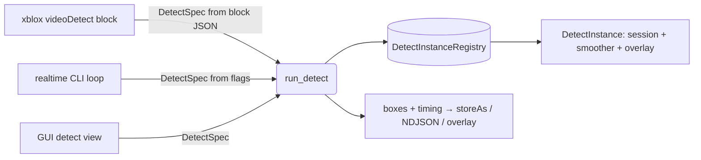

# Detect Instances — low-level, reusable detection state

Status: **proposal** (not yet implemented)

## Goal

Make `videoDetect` (and the realtime CLI, and the GUI) share **persistent,
stateful detection contexts** that survive across calls. This is what makes the
"streaming-only" knobs meaningful for a block that is invoked once per loop pass:

- `smoothAlpha` / `smoothAge` — temporal EMA + box persistence need state across
  frames (passes).
- `visualize` (+ `stats` / `labels` / `fill` / `mode`) — a live overlay window
  must persist across passes, not be created/destroyed each call.
- Model load — loading the ONNX session every pass is wasteful; an instance
  loads it **once**.

Hard constraints from the design discussion:

1. **Managed low-level** — the registry + lifecycle live in core C++, not in the
   UI. The web app stays declarative.
2. **Triggered from many places** — xblox block, realtime CLI, GUI all resolve
   the *same* instance.
3. **Identified by files + pure block data** — instance identity is a hash of
   declarative inputs (model path, input spec, args). No pointers / sessions /
   UI-session objects in the key, so any caller can reconstruct the key.

## Identity & the `instance` arg

```
key = instance.empty()
        ? "auto:" + fnv1a64(canonical_args)     // implicit reuse by identical args
        : "name:" + instance                     // explicit, user-named
```

- `canonical_args` is a stable serialization of the **identity-relevant** fields
  only: `model`, `input`, `provider`, `threads`, `inputSize`, `labels|classes`,
  and the smoothing/visualize config. Per-call *outputs* (`outputPath`) and
  volatile fields are excluded.
- A named instance lets two different blocks (or a CLI run + a block) deliberately
  target the same context. The implicit `auto:` hash means a `videoDetect` inside
  a `for`/`while` with unchanged args automatically reuses one instance — no extra
  wiring needed.

## Data model

New core subsystem (proposed location `src/core/detect_instance.{hpp,cpp}`), so
it sits below both `src/cli` and `src/xblox`:

```cpp
namespace media::detect {

// Pure, hashable description of an instance + one detection call.
struct DetectSpec {
    // ── Identity (hashed) ──
    std::string  model_path;
    std::string  input_spec;     // "" webcam | device name | "screen:N[:title*]"
    std::string  provider = "cpu";   // cpu | cuda
    int          threads   = 4;
    int          input_size = 0;
    std::string  labels_yaml;    // overrides classes
    std::string  classes_csv;
    std::string  instance;       // explicit name; empty = hash of the above

    float        conf = 0.25f;
    float        nms  = 0.45f;

    // Smoothing (temporal) — only applied when an instance persists.
    bool         smooth        = false;
    float        smooth_alpha  = 0.35f;
    int          smooth_age    = 4;

    // Visualization (live overlay window).
    bool         visualize        = false;
    std::string  visualize_mode;       // auto | overlay | preview
    bool         visualize_stats  = true;
    bool         visualize_labels = true;
    int          visualize_fill   = 40;

    // ── Per-call (NOT hashed) ──
    std::string  output_path;    // optional annotated still

    std::string  identity_key() const;   // -> "name:.." | "auto:<fnv1a64>"
};

// The persistent, stateful context. One per identity_key.
struct DetectInstance {
    std::mutex                          mtx;
    media::onnx::OnnxSession            session;     // loaded once
    std::vector<std::string>           class_names;
    BoxSmoother                         smoother;    // carries tracked boxes
#if defined(_WIN32)
    std::unique_ptr<pm::win::DetectOverlay> overlay; // lazy; self-threaded
#endif
    std::uint64_t                       frame_idx   = 0;
    std::chrono::steady_clock::time_point last_used;
    bool                                loaded      = false;
};

// Result of a single run_detect() call.
struct DetectRunResult {
    bool                            ok = false;
    std::string                     error;
    media::onnx::DetectResult       raw;        // unsmoothed boxes (NDJSON / storeAs)
    std::vector<media::onnx::DetectBox> display; // smoothed boxes (overlay / optional)
    std::uint64_t                   frame_idx = 0;
};

} // namespace media::detect
```

## Registry (process-global, low-level)

```cpp
class DetectInstanceRegistry {
public:
    static DetectInstanceRegistry& instance();

    // Look up by key; create + load session if absent. Throws/returns error on load fail.
    std::shared_ptr<DetectInstance> get_or_create(const DetectSpec&, std::string& err);

    void release(const std::string& key);   // explicit teardown (closes overlay, frees session)
    void reset(const std::string& key);      // keep session+overlay, clear smoother tracks
    void evict_idle(std::chrono::milliseconds ttl);  // reaper — close abandoned instances
    void clear();                            // process shutdown / "stop all"

private:
    std::mutex mtx_;
    std::unordered_map<std::string, std::shared_ptr<DetectInstance>> map_;
};
```

The single entry point all callers use:

```cpp
// Resolves (or creates) the instance for spec, captures a frame, runs detection,
// feeds the smoother, updates the overlay, and returns boxes + timing.
DetectRunResult run_detect(const DetectSpec& spec,
                           const std::function<bool()>& cancelled,
                           std::string& err);
```

## Lifecycle

```mermaid
stateDiagram-v2
    [*] --> Created: run_detect(key) miss → load session
    Created --> Active: first frame
    Active --> Active: run_detect(key) hit (reuse session+smoother+overlay)
    Active --> Reset: loop pass with LoopScopePolicy::Reset → smoother.reset()
    Reset --> Active
    Active --> Released: release(key) / videoDetectClose / CLI --instance-close
    Active --> Released: evict_idle(ttl) reaper (abandoned)
    Released --> [*]: overlay.close(), session freed
```

Teardown triggers (all low-level, no UI dependency):

- **Explicit** — a sibling `videoDetectClose` block (same `instance` name) and a
  CLI `--instance-close <name>`.
- **Loop policy** — when a loop ends, the runtime calls `release()` for keys it
  opened (or `reset()` under `LoopScopePolicy::Persist` if we want tracks to
  survive a re-run — TBD, see open questions).
- **Idle reaper** — a low-priority timer calls `evict_idle(ttl)` so a stopped
  loop or crashed caller can't leak an overlay window / GPU session forever.
- **Process exit** — `clear()`.

## Threading

- `DetectOverlay` already spawns its **own** UI thread and `update()` is
  thread-safe (see `detect_overlay.hpp`), so the worker block thread can create
  and drive it directly — no message pump on the caller side.
- xblox loop passes run sequentially on one detached worker thread, so a given
  instance is touched by one thread at a time; the per-instance `mtx` guards the
  rare cross-caller case (e.g. CLI + block hitting the same named instance).

## Integration points



- **Block** (`video_blocks.cpp`): builds a `DetectSpec` from `io.*`, calls
  `run_detect`, emits `raw` boxes as the JSON result (unchanged contract) and lets
  the instance own smoothing/overlay. The current one-shot path becomes the
  `instance==""` + `smooth=false` + `visualize=false` case (identical behavior).
- **CLI** (`pm_image_cmd_video_detect.cpp`): can be refactored to drive
  `run_detect` so the box smoother / overlay logic has a single home. (Optional,
  later — the CLI already has working code; we'd migrate to dedupe.)
- **Shared pieces to relocate**: move `BoxSmoother` to the core subsystem and
  retype it on `media::onnx::DetectBox` (it currently depends on
  `pm::win::DetectBox`); convert to `pm::win::DetectBox` only at the overlay
  boundary. `DetectOverlay` stays in `src/win` (Win32), referenced behind
  `_WIN32`.

## New block params (manifest)

Added to `videoDetect` (all advanced; one-shot defaults keep today's behavior):

| param | kind | default | notes |
|---|---|---|---|
| `instance` | string | `""` | explicit instance name; empty = hash of args |
| `smooth` | bool | `false` | enable temporal smoothing (needs persistent instance) |
| `smoothAlpha` | float | `0.35` | EMA factor 0–1 |
| `smoothAge` | int | `4` | frames a box persists after vanishing |
| `visualize` | bool | `false` | open a live overlay/preview window |
| `visualizeMode` | enum | `auto` | auto \| overlay \| preview |
| `visualizeStats` | bool | `true` | FPS / infer_ms corner text |
| `visualizeLabels` | bool | `true` | label + conf per box |
| `visualizeFill` | int | `40` | box fill opacity 0–255 |

A companion `videoDetectClose` block (param: `instance`) releases the named
instance.

## Phased plan

1. **Core subsystem** — `detect_instance.{hpp,cpp}`: `DetectSpec`, registry,
   `run_detect` (no smoothing/overlay yet — just session reuse + capture +
   detect). Relocate `BoxSmoother`.
2. **Smoothing** — wire `smooth*` into `run_detect` via the per-instance smoother.
3. **Visualize** — lazy overlay in the instance, `visualize*` args, update per call.
4. **Block params + close block** — manifest + handler; one-shot fallback intact.
5. **Lifecycle** — idle reaper + loop-end release hook (tie into `LoopScopePolicy`).
6. **CLI migration (optional)** — refactor the realtime command onto `run_detect`.

## Open questions (need a decision before coding)

1. **Persist vs Reset across a *whole loop re-run*** (not pass-to-pass): when the
   user hits Run again, should a `name:`d instance keep its tracked boxes /
   overlay, or start clean? Proposal: `auto:` keys reset on each Run; `name:` keys
   persist until explicitly closed or reaped.
2. **Idle TTL default** — e.g. 30 s? Should a visible overlay be exempt from the
   reaper while its window is open?
3. **CLI migration now or later** — dedupe immediately, or land the block path
   first and migrate the CLI in a follow-up?
