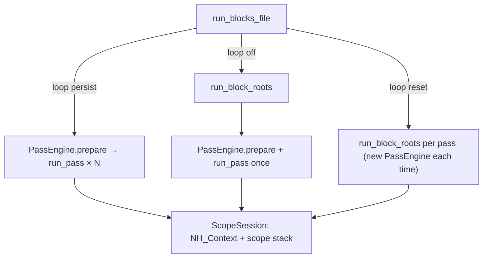
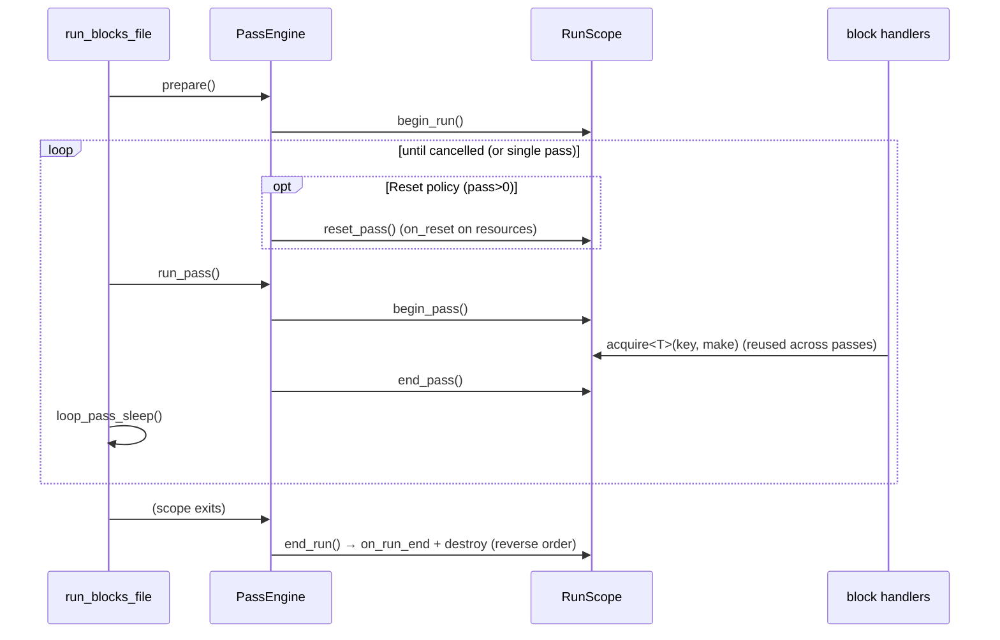

# XBlox runtime lifecycle & resource management

Status: **proposal** (not yet implemented)

## Why

Today the xblox runtime manages **variable scope** well (`ScopeSession` /
`NH_Context` / the numeric store) but has **no concept of a managed resource that
outlives a single block call**. A handler that opens something expensive or
stateful — an ONNX session, a live overlay window, a socket, an audio stream, a
DB handle — has nowhere to put it. It must reopen per call, and there is no hook
that guarantees it gets closed when the run ends or is cancelled.

This is the missing foundation. Once the runtime owns a **run lifecycle** with a
typed resource bag and teardown hooks, "subsequent contexts" like the
video-detect instance (see `xblox-detect-instances.md`) become trivial
consumers: they `acquire()` a resource keyed by their args and let the lifecycle
own creation/reuse/teardown.

It is also **cross-process**: xblox runs in the CLI, the windowed host, and the
daemon, and we need to *collect instances across processes* — enumerate, attach,
stop, status. That layer (see [Cross-process instance registry](#cross-process-instance-registry))
reuses the existing `rt_ipc` mmap-singleton pattern, generalized to many
instances keyed by a hash of the **file** (file-backed runs) or of **all block
data** (inline runs). The in-process `RunScope` owns the cross-process presence
as just another lifecycle resource.

## Current state (what we build on)



- `PassEngine` already is the per-run state holder: `context` JSON,
  `NumericContextStore`, `ScopeSession`, compiled program. Single run =
  `prepare()` + one `run_pass()`; persisting loop = `prepare()` once + `run_pass()`
  per iteration.
- **Gap 1**: nothing owns non-variable resources, and there are no
  begin/end/teardown hooks.
- **Gap 2**: the **Reset** loop policy builds a *new* `PassEngine` per pass via
  `run_block_roots`, so even if resources existed they couldn't persist or be
  told to "reset" — they'd be destroyed and rebuilt blindly.

## Proposal: `RunScope`

A new runtime-owned object that represents one **run** (a single execution or a
whole loop) and owns a **typed resource bag** plus lifecycle phases. It lives
beside `ScopeSession` inside `PassEngine`, and is reachable from handlers through
`BlockRuntime` / `BlockIO`.

```cpp
namespace media::xblox {

class RunScope;

// Base for anything the runtime should own for the duration of a run.
// Hooks are optional; default to no-ops. Destruction is the hard teardown.
struct LifecycleResource {
    virtual ~LifecycleResource() = default;
    virtual void on_pass_begin(RunScope&) {}
    virtual void on_pass_end(RunScope&)   {}
    virtual void on_reset(RunScope&)      {}   // LoopScopePolicy::Reset, per pass
    virtual void on_run_end(RunScope&)    {}   // graceful teardown before dtor
};

enum class RunPhase { Idle, Running, PassActive, Cancelled, Ended };

class RunScope {
public:
    RunScope(const ExecutionOptions& opts) : opts_(opts) {}
    ~RunScope() { end_run(); }                  // RAII teardown (idempotent)

    // ── Resource bag — keyed, typed, created on first acquire ────────────────
    template <class T, class Factory>
    std::shared_ptr<T> acquire(const std::string& key, Factory&& make) {
        auto it = bag_.find(key);
        if (it != bag_.end())
            return std::static_pointer_cast<T>(it->second);
        std::shared_ptr<T> res = std::forward<Factory>(make)();   // T : LifecycleResource
        order_.push_back(key);
        bag_.emplace(key, res);
        if (phase_ == RunPhase::PassActive) res->on_pass_begin(*this);
        return res;
    }
    bool has(const std::string& key) const { return bag_.count(key) != 0; }
    void release(const std::string& key);     // on_run_end + erase

    // ── Phase drivers (called by PassEngine, not handlers) ───────────────────
    void begin_run();
    void begin_pass();
    void end_pass();
    void reset_pass();      // Reset policy: re-seed + on_reset() each pass
    void end_run();         // teardown all, reverse acquisition order; idempotent

    // ── Context for resources/handlers ───────────────────────────────────────
    RunPhase                phase()      const { return phase_; }
    std::uint64_t           pass_index() const { return pass_; }
    const ExecutionOptions& options()    const { return opts_; }
    bool                    cancelled()  const;   // proxies opts_.cancel_requested

private:
    const ExecutionOptions& opts_;
    RunPhase phase_ = RunPhase::Idle;
    std::uint64_t pass_ = 0;
    std::unordered_map<std::string, std::shared_ptr<LifecycleResource>> bag_;
    std::vector<std::string> order_;   // teardown is reverse of this
};

} // namespace media::xblox
```

Notes:

- The bag stores `shared_ptr<LifecycleResource>`; `acquire<T>` returns a typed
  handle. `T` derives from `LifecycleResource`.
- `end_run()` calls `on_run_end()` then drops each resource in **reverse**
  acquisition order, and is called from both the explicit loop-exit path and the
  destructor, so cancellation / exceptions still tear everything down.

## PassEngine integration (incl. the Reset refactor)

`PassEngine` gains a `RunScope` and drives its phases. Crucially, we make a
**single `PassEngine` (and `RunScope`) span the whole loop for *both*
policies** — Reset stops meaning "throw the engine away each pass" and starts
meaning "re-seed scope + tell resources to `on_reset()`". This is what lets a
Reset loop keep an ONNX session warm while clearing the smoother.

```cpp
struct PassEngine {
    nlohmann::json       context;
    NumericContextStore  numeric_context;
    ScopeSession         scope_session;
    RunScope             run_scope;            // NEW — owns resources for the run
    std::vector<CompiledBlock> compiled;
    bool use_compiled = false;

    void prepare(...);                          // + run_scope.begin_run()
    void run_pass(...) {                        // run_scope.begin_pass()/end_pass()
        run_scope.begin_pass();
        FlowState flow; flow.scopes = &scope_session.stack();
        flow.run_scope = &run_scope;            // thread into BlockRuntime
        /* compiled or interpreted execute … */
        run_scope.end_pass();
    }
    void reset_for_pass(...) {                   // Reset policy between passes
        re_seed_context_and_scope(...);
        run_scope.reset_pass();                  // resources clear transient state
    }
    // dtor → run_scope.end_run() via RAII
};
```

`run_blocks_file` loop becomes one shape for both policies:



## Handler-facing API (`BlockIO`)

`BlockRuntime` carries a `RunScope*` (set per pass from `FlowState`), exposed via
a thin accessor so handlers never touch the engine directly:

```cpp
// in a block handler
auto sock = io.run().acquire<ModbusConn>("modbus:" + host, [&]{
    return std::make_shared<ModbusConn>(host, port);   // : LifecycleResource
});
sock->read(...);   // reused next pass; closed at run end / cancel
```

- `io.run()` returns `RunScope&` (or a narrow facade exposing just `acquire` /
  `has` / `pass_index` / `cancelled`).
- One-shot blocks ignore it entirely — behaviour unchanged.

## LoopScopePolicy semantics, unified

| | variables (ScopeSession) | resources (RunScope bag) |
|---|---|---|
| **Persist** (default) | carry across passes (`n` climbs) | kept; `on_pass_begin/end` each pass |
| **Reset** | re-seeded from doc context each pass | kept alive, but `on_reset()` each pass |

So "Reset" no longer implies tearing down expensive resources — it means *logical*
restart of state. Resources decide what reset means (smoother clears tracks; ONNX
session does nothing).

## Teardown, cancellation, exceptions

- `RunScope::end_run()` is **idempotent** and invoked from both the normal
  loop-exit and the `PassEngine` destructor → guaranteed teardown on cancel,
  error, or normal completion.
- Teardown order is **reverse acquisition** so dependents close before
  dependencies.
- A resource's `on_run_end()` is the graceful hook (flush, close window, join
  thread); the destructor is the hard backstop.

## Threading

- A run executes on one worker thread; `RunScope` is **single-threaded within a
  run**, so the bag needs no internal locking.
- Resources that themselves span threads (e.g. a self-threaded overlay) or that a
  *global* registry shares across runs manage their own synchronization. The
  `RunScope` bag is per-run; a process-global registry (like detect instances) is
  a separate layer that a `RunScope` resource can wrap and reference-count.

## Cross-process instance registry

`RunScope` above is **in-process** — it owns resources for one run on one thread.
But xblox runs happen in **many processes**: a `tanit-cli xblox run`, the
windowed `tanit.exe` host, a daemon, a context-menu re-launch. We need to
**collect xblox instances across processes** — enumerate what's running, attach,
signal stop, read status — exactly the problem `pm::audio::rt_ipc` already solves
for the realtime voice session, but for *N* instances instead of one singleton.

### Reuse, don't reinvent

| Existing | What it gives us | How we extend it |
|---|---|---|
| `rt_ipc` (mmap singleton under config dir: `Owner.acquire` / `request_stop` / `read_status` / `cleanup_stale`) | Cross-process ownership + cooperative stop + stale reaping, via a pid-stamped shared file | Generalize from one fixed file to a **directory of per-instance descriptors** keyed by hash |
| `ProcessRunner` kill-on-close **Job Object** | Bound children die with the host (crash net) | Instance descriptors are reaped by pid-liveness; the job handles process trees |
| `cmd_run::Runner` (per-process sink/metadata) | Rich labels for UI-launched runs | Stays the in-process view; the cross-process registry is the system-wide view |

### Identity — files (hash key) + pure block data (hash all)

Every instance has a stable key so the same xblox maps to the same registry slot
across processes:

```
instance_key =
    file-backed ? "file:" + fnv1a64(canonical_lowercased_path)  // + optional content hash
                : "data:" + fnv1a64(canonical_json(roots, context, loop))   // hash ALL block data
```

- **File-backed** runs (`xblox run foo.xblox`) key off the **file** — the path is
  the identity; an optional content hash (size+mtime or digest) distinguishes an
  edited file from the one already running.
- **Inline / pure block data** (host sends a document, no file) keys off a
  canonical serialization of the **entire** block data — stable key order, volatile
  UI fields stripped — so identical documents collide deliberately (dedupe) and
  different ones don't.

### Not persistence — an ephemeral rendezvous

The files are a *cross-process rendezvous*, not durable state: written on
`begin_run`, removed on `end_run`, stale-reaped on crash — exactly the lifecycle
of `rt_ipc`'s `realtime-voice.session` file. Nothing survives a reboot.

It must be **file-backed** (not anonymous shared memory) for one reason:
**enumeration**. "Collect instances across processes" requires a discoverable
namespace, and a directory listing gives that for free. `shm_open` / named Win32
mappings are not portably enumerable, so they can't answer "what's running?".

All of this is already cross-platform in `rt_ipc`: path via
`media::settings::get_config_dir()`, pid liveness via `OpenProcess` (Win) /
`kill(pid,0)` (POSIX), and both `CreateFileMappingW` and `mmap(MAP_SHARED)`
branches exist.

### Shared layout — portable baseline (no mmap)

Per instance, under `get_config_dir()/xblox/instances/`:

- `<key>.json` — the descriptor (write-tmp-then-`rename()` for atomicity):
  `key`, `kind` (`file`|`data`), `source` (path or `""`), `file_hash`,
  `data_hash`, `label`, `loop {enabled,intervalMs,reset}`, `exe`, `cwd`, `pid`,
  `started_unix_ms`, `state`, `pass_index`, `heartbeat_unix_ms`.
- `<key>.stop` — a **sentinel file**. To stop, any process creates it; the owner
  tests `exists()` in its per-pass cancel check (latency = one loop tick, which is
  fine — the loop already sleeps between passes). Create/unlink is atomic on NTFS
  and POSIX, so no mmap, packed struct, or endianness concerns. Fully identical on
  Win/macOS/Linux.

Liveness = pid probe + the periodically-rewritten `heartbeat_unix_ms` (catches a
hung owner whose pid is still alive).

### Optional later: mmap `.ctl` fast path

Only if sub-tick stop latency or cheap shared counters matter (they don't for
human-scale loops). Mirrors `rt_ipc::SessionShared` — a fixed `#pragma pack(1)`
struct (`magic`, `version`, `state`, `stop`, `pid`, `started_unix_ms`,
`heartbeat_unix_ms`, `pass_index`) mapped via the existing Win32/POSIX branches.
Same machine + same arch → no byte-order issues. Not on the critical path.

### Owner = a `RunScope` resource

The cross-process registration is just **one more `LifecycleResource`** the run
acquires — so the in-process lifecycle owns the cross-process presence too:

```cpp
struct XbloxInstanceOwner : LifecycleResource {
    bool acquire(const InstanceInfo&, std::string& err);  // write <key>.json (tmp→rename)
    bool stop_requested() const;                          // exists(<key>.stop) [|| .json stop]
    void on_pass_begin(RunScope&) override;               // rewrite heartbeat + pass_index
    void on_run_end(RunScope&) override;                  // state=Done, remove <key>.json/.stop
};
```

- `RunScope::begin_run()` acquires it (for discoverable runs — see open Q4) and
  wires `owner.stop_requested()` into the run's cancel predicate, so a stop
  signalled from *any* process cancels the loop cooperatively (same mechanism as
  `rt_ipc` flipping the realtime session's `stop`).
- `on_run_end()` (RAII, fires on cancel/crash-handled/normal) removes the
  descriptor; a `cleanup_stale()` reaper drops entries whose `pid` is dead or whose
  heartbeat is stale, so a hard crash can't leak registry slots.

### Cross-process operations (any surface / CLI verb)

```mermaid
flowchart LR
    subgraph procA["process A — tanit-cli xblox run foo.xblox (looping)"]
      RSA[RunScope] --> OWN[XbloxInstanceOwner: file:hash]
      OWN --> DESC[("xblox/instances/file_hash.json")]
    end
    subgraph procB["process B — tanit xblox instances …"]
      LIST["list → enumerate *.json, filter live (pid/heartbeat)"]
      STOP["stop --key file:hash → create file_hash.stop"]
      STAT["status --key → read file_hash.json"]
    end
    LIST --> DESC
    STOP -.creates .stop sentinel.-> DESC
    DESC -.owner polls exists(.stop).-> OWN
    OWN -.cooperative cancel.-> RSA
```

Proposed verbs (mirroring `--realtime-status/-stop`): `xblox instances list`,
`xblox instances stop --key|--pid`, `xblox instances status --key`,
`xblox instances reap` (stale cleanup).

## Cross-instance communication (XbloxBus)

The registry above is a **control plane**: discover (who/where) and stop
(one-way). It is *not* a message channel — files give passive state, not live
two-way data. For instances to actually **talk** (send a value, request a
result, broadcast an event) we need a **data plane**: a real socket transport.

This is built **from scratch and self-contained in xblox** — it does *not* reuse
`src/ipc` (that's a disabled resize-job server for another purpose). It uses
**standalone asio** (already a dep: `ASIO_STANDALONE`, FetchContent in
`CMakeLists.txt`), nothing else.

### Two planes, one identity

```
control plane  →  get_config_dir()/xblox/instances/<key>.json   (discover + stop)
data plane     →  asio socket advertised in that same <key>.json (talk)
```

The descriptor gains two fields so peers can find the live endpoint:

```jsonc
{ "key": "file:…", "pid": 1234, /* … */
  "endpoint": "127.0.0.1:53417",   // loopback acceptor for this instance
  "token": "9f3c…"                  // per-instance secret; clients must present it
}
```

### Transport choice

| Option | Portability with asio | Notes |
|---|---|---|
| **Loopback TCP** (`127.0.0.1:ephemeral`) | **Uniform** — identical asio code on Win/macOS/Linux | Port visible to other local users → gate with the per-instance `token`; bind loopback only |
| UDS (POSIX) / named pipe (Win) | Diverges (`asio::local::stream_protocol` vs Win pipe/`windows::stream_handle`) | OS per-user ACLs, no port; nicer but two code paths |

**Proposal: loopback TCP + token baseline** (one code path, from scratch),
UDS/named-pipe as an optional later hardening. Same-user config dir already
scopes discovery; the token stops same-machine cross-user connects.

### `XbloxBus` — a `LifecycleResource`

The bus is just another resource the run owns, so it opens on `begin_run` and is
torn down (acceptor closed, io_context stopped, thread joined) on `end_run` /
cancel / crash-handled — RAII, same as everything else.

```cpp
struct XbloxBus : LifecycleResource {
    bool open(std::string& err);              // bind loopback, start io thread, write endpoint+token
    // directed + broadcast send (resolves targets via the registry descriptors)
    bool send(const std::string& to_key, const Msg&, std::string& err);
    int  broadcast(const Msg&);               // to all live peers; returns count
    Reply request(const std::string& to_key, const Msg&, int timeout_ms, std::string& err);
    // inbound: blocks drain the inbox on the run thread (single-threaded handlers)
    bool poll(Msg& out);                       // non-blocking pop
    void on_run_end(RunScope&) override;       // close acceptor, stop io_context, join
private:
    asio::io_context io_;
    std::thread      io_thread_;               // runs io_.run()
    /* acceptor, sessions, thread-safe inbox queue, token */
};
```

### Message envelope (JSON, length-prefixed frames)

```jsonc
{ "id": "uuid", "from": "file:…", "to": "name:foo",
  "type": "event|request|reply", "reply_to": "id|null",
  "payload": { /* arbitrary */ } }
```

- **Fire-and-forget**: `type:event`.
- **Request/reply**: `type:request` + correlation `id`; peer answers `type:reply`
  with `reply_to`. `request()` blocks (with timeout) on the run thread.
- Framing is length-prefixed JSON (not newline) so binary-ish payloads are safe.

### Block-facing surface

```cpp
// send to a named instance
io.run().bus().send("name:detector", Msg{"event", {{"frame", n}}}, err);
// receive — a block drains the inbox (runtime delivers on the run thread)
Msg m; while (io.run().bus().poll(m)) { /* handle */ }
```

Natural blocks later: `xbloxSend` (to key, payload), `xbloxBroadcast`,
`xbloxOnMessage` (container whose children run per inbound message),
`xbloxRequest` (send + await reply). All thin wrappers over `XbloxBus`.

### Threading & safety

- One `io_context` on a dedicated thread per instance; inbound frames are parsed
  there and **posted to a thread-safe inbox**. Block handlers only ever touch the
  inbox via `poll()` **on the run thread**, so handler code stays single-threaded
  (consistent with the rest of the runtime).
- `request()` uses a condition-variable keyed on the correlation id, woken by the
  io thread — the only cross-thread rendezvous, fully contained in `XbloxBus`.
- Teardown order (reverse-acquire) means the bus closes before lower-level
  resources; sessions are cancelled and the io thread joined in `on_run_end`.

## How video-detect slots in (later)

Once this lands, `xblox-detect-instances.md` collapses to:

- `DetectInstance : LifecycleResource` (session + smoother + overlay).
- The block does `io.run().acquire<DetectInstance>(spec.identity_key(), make)`.
- `on_reset()` → `smoother.reset()`; `on_run_end()` → close overlay, free session.
- No bespoke registry/reaper needed for the common case — the run owns it. A
  process-global registry is only needed if instances must be shared *between*
  runs (CLI + block simultaneously), which becomes an optional wrapper.

## Phased plan

1. **`RunScope` + `LifecycleResource`** (`src/xblox/runtime_scope.{hpp,cpp}`):
   bag, phases, RAII teardown. No callers yet.
2. **Thread it through**: `FlowState.run_scope`, `BlockRuntime`, `BlockIO::run()`.
3. **PassEngine phases**: `begin_run/begin_pass/end_pass/end_run`; unify the loop
   so one engine spans both policies; Reset → `reset_pass()`.
4. **Smoke**: a trivial `LifecycleResource` (counter that survives passes,
   resets under Reset, logs teardown) verified in `test-xblox-next.mjs`.
5. **Adopt**: migrate one real consumer (audio stream or modbus conn) to prove
   the API, then video-detect instances.
6. **Cross-process registry** (`src/core/xblox_instance_ipc.{hpp,cpp}`):
   generalize `rt_ipc` to a hashed directory of `<key>.ctl`+`.json` descriptors;
   `XbloxInstanceOwner : LifecycleResource`; wire `stop_requested()` into the run
   cancel predicate; `cleanup_stale()` reaper.
7. **CLI surface**: `xblox instances list|stop|status|reap` verbs (mirror
   `--realtime-status/-stop`), reusing the descriptor reader.
8. **XbloxBus** (`src/xblox/xblox_bus.{hpp,cpp}`): self-contained asio loopback
   server + client, length-prefixed JSON frames, per-instance token; advertise
   `endpoint`/`token` in the descriptor; `XbloxBus : LifecycleResource`.
9. **Messaging blocks**: `xbloxSend` / `xbloxBroadcast` / `xbloxOnMessage` /
   `xbloxRequest` over the bus.

## Open questions

1. **Facade vs full `RunScope&`** exposed to handlers — lock it down to
   `acquire/has/pass_index/cancelled`, or hand over the whole object?
2. **Keying convention** — freeform string keys, or a typed key helper
   (`typeid(T)` + user suffix) to avoid collisions across blocks?
3. **Nested container scopes** — do `for`/`while`/`isolate` child frames get
   their own resource sub-scope, or is the bag strictly run-level? (Proposal:
   run-level only for now; revisit if a per-iteration resource need appears.)
4. **Background blocks** (`BlockRunFlag::Background`) outliving the run — do they
   keep the `RunScope` alive (shared_ptr) or get detached with their own?
5. **Which runs register cross-process** — *all* runs, or only looping /
   explicitly-named ones? (One-shot CLI verbs are short-lived; registering them
   adds churn. Proposal: register looping runs + any run with an explicit
   instance name; skip transient one-shots.)
6. **Same key, two processes** — singleton (refuse the second, like `rt_ipc`),
   or co-exist and let the registry hold `key → [pids]`? File-backed edited-while-
   running is the tricky case (path same, content hash differs).
7. **Liveness** — heartbeat timestamp in the `.ctl`, pid `OpenProcess` probe, or
   both? (rt_ipc uses pid; a heartbeat also catches hung owners.)
8. **Stop transport** — sentinel `<key>.stop` + per-pass `exists()` poll
   (portable, zero mmap; proposal) vs an mmap `.ctl` flag for sub-tick latency.
   Loops sleep between passes, so the poll is almost certainly enough.
9. **Bus transport** — loopback TCP + token (one asio code path; proposal) vs
   UDS/named-pipe (OS ACLs, no port, but per-platform code).
10. **Inbound delivery** — `poll()` inbox drained on the run thread (simple,
    single-threaded handlers; proposal) vs callback dispatch. And do we need
    request/reply in v1, or start fire-and-forget + broadcast only?
11. **Bus opt-in** — every registered instance opens a bus, or only when the
    document uses a messaging block / passes `--bus`? (Avoid binding sockets for
    runs that never message.)
